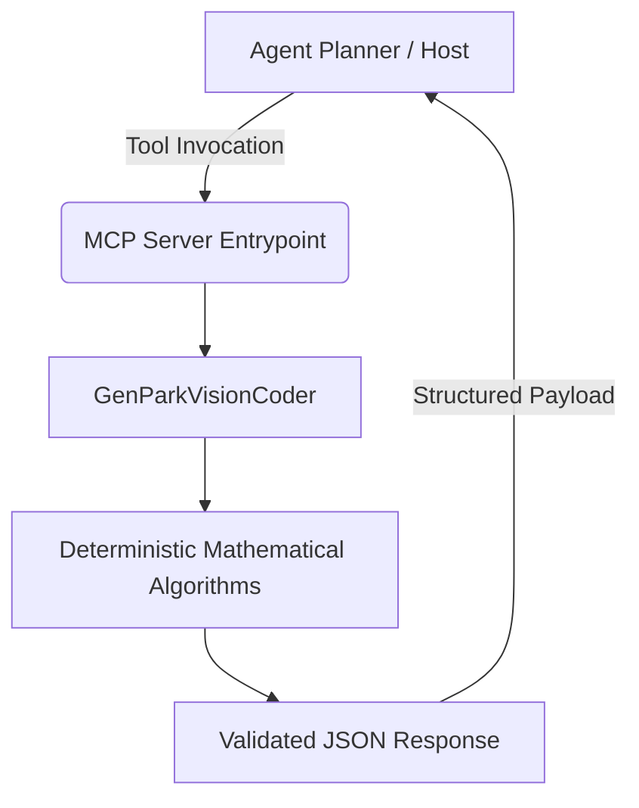

# genpark-vision-coder

[](https://github.com/Alpha-Park/genpark-vision-coder)
[](requirements.txt)
[](https://modelcontextprotocol.io/)
[](https://opensource.org/licenses/MIT)
[](https://github.com/Alpha-Park/genpark-vision-coder)

Production-grade agentic skill designed for the OpenClaw and GenPark swarms. The core Python client uses the standard library; the MCP server uses the official MCP SDK.

## Architecture & Flow



## Features

- **Standard-Library Client**: The core algorithms need no third-party packages; MCP server operation requires the MCP SDK.
- **Model Context Protocol (MCP)**: Native FastMCP JSON-RPC interface for seamless tool-calling in Claude, Cursor, and OpenClaw.
- **Algorithmic Rigor**: Rigorous closed-form mathematical equations and quantitative deterministic metrics.
- **Public Repository**: Source and documentation are maintained under `Alpha-Park`.

## Installation & Usage

```bash
git clone https://github.com/Alpha-Park/genpark-vision-coder.git
cd genpark-vision-coder
python example_usage.py
```

## MCP Configuration

The core Python client uses only the standard library. Running the MCP server requires **Python 3.10+** and the official **`mcp>=1.0.0,<2` SDK**. From the repository directory:

```bash
python -m venv .venv
.venv/bin/python -m pip install -r requirements.txt
```

On Windows, use `.venv\Scripts\python.exe` instead. Configure the MCP client to use this environment's Python executable. The server runs locally over stdio; the GitHub repository URL is not a remote MCP endpoint.


Add to your `claude_desktop_config.json`, replacing `/absolute/path/to` with the local checkout path:
```json
{
  "mcpServers": {
    "genpark-vision-coder": {
      "command": "/absolute/path/to/genpark-vision-coder/.venv/bin/python",
      "args": ["/absolute/path/to/genpark-vision-coder/mcp_server.py"]
    }
  }
}
```

## License

MIT License. See [LICENSE](LICENSE) for details.
